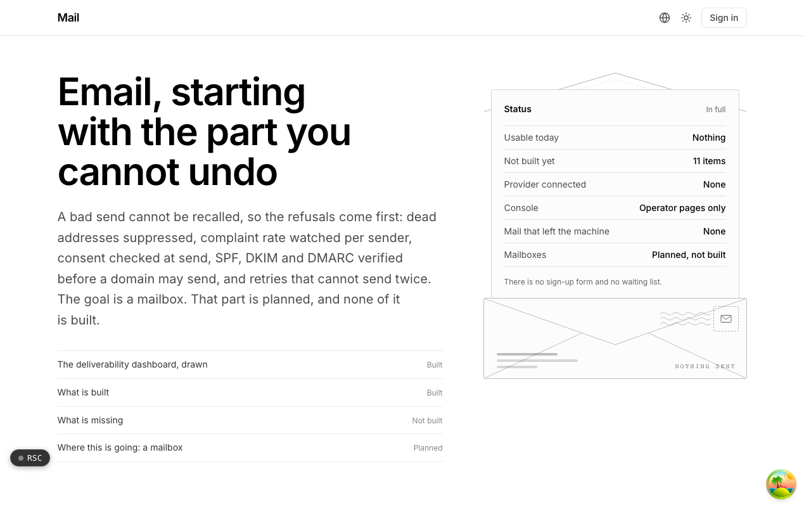
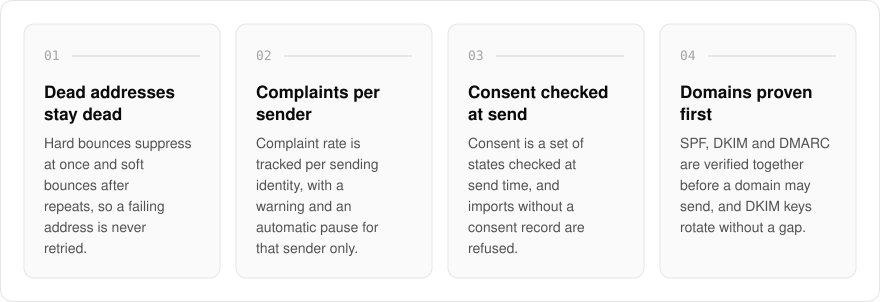
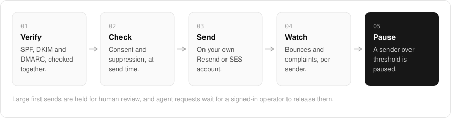

  <picture>
    <source media="(prefers-color-scheme: dark)" srcset=".github/assets/hero-dark.png">
    
  </picture>

<h1 align="center">mail.me.at</h1>

<strong>Email, starting with the part you cannot undo.</strong>

  
  
  
  

  <a href="#features">Features</a> ·
  <a href="#how-it-works">How it works</a> ·
  <a href="#built-with">Built with</a>

A bad send cannot be recalled: one list without consent or one burst of dead addresses can damage a sending domain's reputation. I am building mail.me.at as newsletters and broadcast email on your own Resend or SES account, with deliverability treated as ongoing work, so I built the refusals first: dead addresses suppressed, complaint rate watched per sender, consent checked at send, and SPF, DKIM and DMARC verified before a domain may send. There is no public sending surface yet. What runs today is a set of operator-only pages behind sign-in, and a mailbox (an address and an inbox) is the planned destination, not something that exists.

  <picture>
    <source media="(prefers-color-scheme: dark)" srcset=".github/assets/overview-dark.svg">
    
  </picture>

## Why mail.me.at

| The usual newsletter tool | mail.me.at |
| --- | --- |
| Imports any list you upload | Refuses imports without a consent record |
| One complaint rate for the whole account | Tracked per sending identity, with a pause that leaves other senders alone |
| An inbox-placement score | Real send outcomes per identity, and no invented placement number |
| An agent with an API key can send | Agents ask over MCP, and nothing is sent until a signed-in operator releases it |

## Features

- **Bounce suppression**: hard bounces suppress an address at once and soft bounces after repeated events, so a permanently failing address is never retried.
- **Per-sender complaint monitoring**: complaint rate is tracked per sending identity, with a warning threshold and an automatic pause that leaves other identities alone.
- **Consent lifecycle**: consent is a set of states checked at send time, and imports without a consent record are refused.
- **Domain authentication**: SPF, DKIM and DMARC are verified together, DKIM keys rotate through two selectors without a gap in signing, and new identities are warmed up gradually.
- **Safe sending**: List-Unsubscribe and one-click headers on every message, a guard so a retry cannot double-send, and large first sends held for human review.
- **DMARC report ingest**: aggregate reports are parsed and folded per domain, telling spoofing apart from your own senders losing alignment.
- **Operator deliverability dashboard**: send outcomes per identity, complaint posture and suppression by reason, with no invented inbox-placement number.
- **Agents ask, a human releases**: agents can request a single email over MCP; nothing is sent until a signed-in operator releases or rejects it.

## How it works

  <picture>
    <source media="(prefers-color-scheme: dark)" srcset=".github/assets/flow-dark.svg">
    
  </picture>

A domain may send only once SPF, DKIM and DMARC verify together. Each message is checked against the recipient's consent state and the suppression list at send time, then handed to your own Resend or SES account with unsubscribe headers attached. Bounces and complaints come back per sending identity, and an identity that crosses its complaint threshold is paused without touching the others.

## Built with

  
  
  
  
  
  

- Next.js 16 (App Router), React 19, TypeScript
- Tailwind CSS 4
- Drizzle ORM + Postgres
- Better Auth
- oRPC
- Resend (sending provider) and an MCP endpoint for agent requests

## Part of the me.at family

mail.me.at is one of my [`*.me.at`](https://me.at) apps. They share one design system, account, and app shell. Development happens in a private monorepo; this repository is the project's public-facing home.

## License

Source-available. See [LICENSE](LICENSE).
